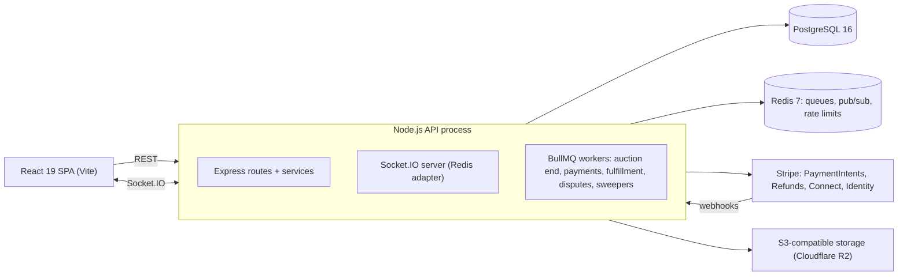
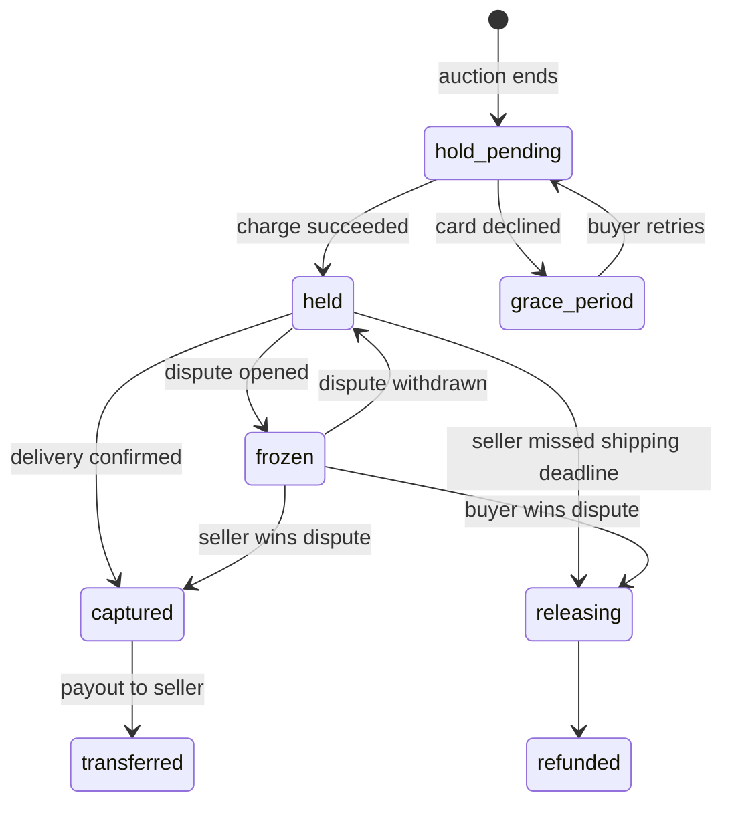

# Realtime Auction Platform

A realtime online auction marketplace with **escrow payments**: buyers bid live over WebSockets, the winner is charged
when the auction closes, and the money is held by the platform until the item is delivered — then paid out to the seller,
or refunded if the seller never ships or loses a dispute.

The goal of the project is not the number of screens but getting the hard parts right: **concurrent bids, closing an
auction that keeps being extended, and moving money exactly once** even when processes crash or Stripe times out.
Every one of those guarantees is covered by integration tests against real PostgreSQL and Redis.

> Demo video: coming soon.

---

## Features

| Area | What it does |
|---|---|
| Live bidding | Socket.IO rooms per auction, outbid notifications, sequence numbers + catch-up after reconnect |
| Anti-sniping | A bid in the last 2 minutes extends the auction by 5 minutes; the close job follows the new deadline |
| Escrow | Winner is charged at auction end (Stripe), funds are `held` by the platform until delivery |
| Fulfillment | Seller ships with carrier + tracking; buyer confirms delivery, or it auto-confirms after 14 days |
| Failure paths | 24h grace period when the card fails, then a second-chance offer to the runner-up; full refund if the seller misses the shipping deadline |
| Disputes | Buyer opens a dispute, seller has a 72h evidence window, admin resolves (refund or release) |
| Seller onboarding | Stripe Identity (KYC) and Stripe Connect payouts |
| Admin | User/auction oversight, bans with preview, categories, dispute desk, audit log |
| Platform fee | Tiered fee per sale (configurable in `platform_settings`), deducted from the seller payout |
| Buyer tools | Search, filters, cursor pagination, watchlist, notification center |

## Architecture



One deployable API process runs HTTP, WebSockets and the background workers. State that must survive restarts lives in
PostgreSQL; Redis carries queues, pub/sub fan-out and short-lived counters.

**Stack:** Node.js (ESM), Express 4, PostgreSQL (`pg`, hand-written SQL, `node-pg-migrate`), Redis + BullMQ, Socket.IO,
Stripe, React 19 + React Router 7, Vitest + Testcontainers, Playwright, GitHub Actions. npm workspaces monorepo
(`apps/api`, `apps/web`, `packages/shared-constants`).

## The interesting problems

### 1. Concurrent bids without a race
A bid is a single conditional `UPDATE` on the auction row:

```sql
UPDATE auctions
SET current_price = $1,
    end_at = CASE WHEN end_at - now() < interval '2 minutes'
                  THEN end_at + interval '5 minutes' ELSE end_at END
WHERE id = $2 AND status = 'active' AND now() < end_at
  AND current_price + bid_increment <= $1
RETURNING *;
```

Price check, deadline check and anti-snipe extension happen atomically, so two equal bids can never both win. An
integration test fires 30 concurrent bids and asserts exactly one winning bid equal to `current_price`.

### 2. Closing an auction that keeps moving
The close job and bids serialize on the same row lock: the job takes `SELECT ... FOR UPDATE`, re-checks
`now() >= end_at` with the database clock, picks the winner and changes the status in one transaction. If a last-second
bid extended the deadline, the job calls `job.moveToDelayed()` instead of re-adding a job with the same id (which BullMQ
would silently drop while the job is still active). Tests interleave a bid and the close job on real Postgres, and run the
reschedule on a real BullMQ queue.

### 3. Escrow that moves money exactly once
Card authorizations expire after ~7 days, shorter than a shipping + delivery window, so the winner is **charged
immediately** and the platform holds the funds:



Charging is the part that has to survive crashes and timeouts:

- **Charge attempts ledger** (`payment_attempts`). Before Stripe is called, an attempt row is inserted in the same
  transaction that claims the payment. Its id is the Stripe idempotency key; a partial unique index allows only one
  in-flight attempt per payment.
- **Lease + fencing token.** Only the holder of the attempt's lease may call Stripe or record an outcome; every outcome
  update is conditioned on the lease and on the attempt still being `pending`, so a stale request cannot overwrite a
  newer one.
- **Uncertain outcomes stay uncertain.** A timeout, a `processing` PaymentIntent or a failed DB write after a successful
  charge leaves the payment in `hold_pending` — it is never handed to the next buyer while the first one may have been
  charged. The API answers `503 PAYMENT_PROCESSING`.
- **Reconciler.** A sweeper resolves pending attempts by retrieving the PaymentIntent or searching Stripe by
  `metadata.attempt_id`; it never creates a second PaymentIntent for an attempt, even after the 24h idempotency window.
- **Orphan refunds.** A charge that succeeds after its attempt was given up on is recorded as a refund obligation first
  and refunded with retries until Stripe confirms it.
- **One payment per auction**, enforced by a unique index; dispute outcomes are claimed in the same transaction that
  moves the funds, so a refund and a payout can never both happen.

The design went through several rounds of adversarial review; the reasoning and the state machine are kept in the
design notes rather than in code comments.

## Testing

| Suite | What it covers | Command |
|---|---|---|
| API unit (Vitest) | services and validation with mocked I/O | `npm test -w @auction/api` |
| API integration (Vitest + Testcontainers) | real PostgreSQL 16 + Redis 7 containers, migrations applied: concurrent bids, close/bid interleavings, BullMQ rescheduling, escrow charge/retry/reconcile, release/refund/dispute races, cursor pagination over HTTP | `npm run test:integration -w @auction/api` |
| E2E (Playwright) | browse and layout flows in the web app | `npm run test:e2e` |

Integration tests need Docker. CI (GitHub Actions) runs web lint + build, API unit tests and API integration tests on
every pull request.

## Running locally

Requirements: Node.js 22, Docker.

```bash
# 1. Infrastructure (PostgreSQL on 5433, Redis on 6380)
docker compose up -d

# 2. Dependencies
npm install

# 3. Configuration
cp apps/api/.env.example apps/api/.env   # set DATABASE_URL, REDIS_URL, JWT secrets, Stripe test keys
cp apps/web/.env.example apps/web/.env   # VITE_API_URL, VITE_STRIPE_PUBLIC_KEY

# 4. Database
npm run migrate:up -w @auction/api
npm run db:seed

# 5. Run (two terminals)
npm run dev:api    # http://localhost:3000
npm run dev:web    # http://localhost:5173
```

Seeded accounts (password `password123`): `seller@example.com` (verified seller), `bidder@example.com` (buyer),
`unverified@example.com`. To try the admin console, set `role = 'admin'` on a user in the `users` table.

Stripe runs in test mode; use the test card `4242 4242 4242 4242`. To receive webhooks locally:
`stripe listen --forward-to localhost:3000/webhooks/stripe`.

## Project structure

```
apps/
  api/
    migrations/          node-pg-migrate migrations
    src/
      routes/ controllers/ validations/ middleware/
      services/          business logic (bidding, payment, fulfillment, dispute, payout, reconciler, ...)
      jobs/              BullMQ queues and workers (auction end, payments, fulfillment, disputes, webhooks)
      config/            database, redis, socket.io, stripe
    tests/unit/  tests/integration/
  web/
    src/core/            api client, contexts (auth, socket), hooks
    src/features/        auctions, dashboard, disputes, admin, seller, watchlist, ...
packages/
  shared-constants/      status enums, error codes and event names shared by API and web
e2e-tests/               Playwright specs
```

## Known limitations

- Single API process: HTTP, sockets and workers scale together. The Socket.IO Redis adapter and BullMQ make splitting
  them a deployment change, not a rewrite, but it has not been load-tested.
- Banning a user does not yet settle that user's held escrow payments (the ban preview counts them).
- No proxy (maximum) bidding yet.
- Payments use Stripe test mode only; Stripe Connect payouts are not available for sellers in every country.
